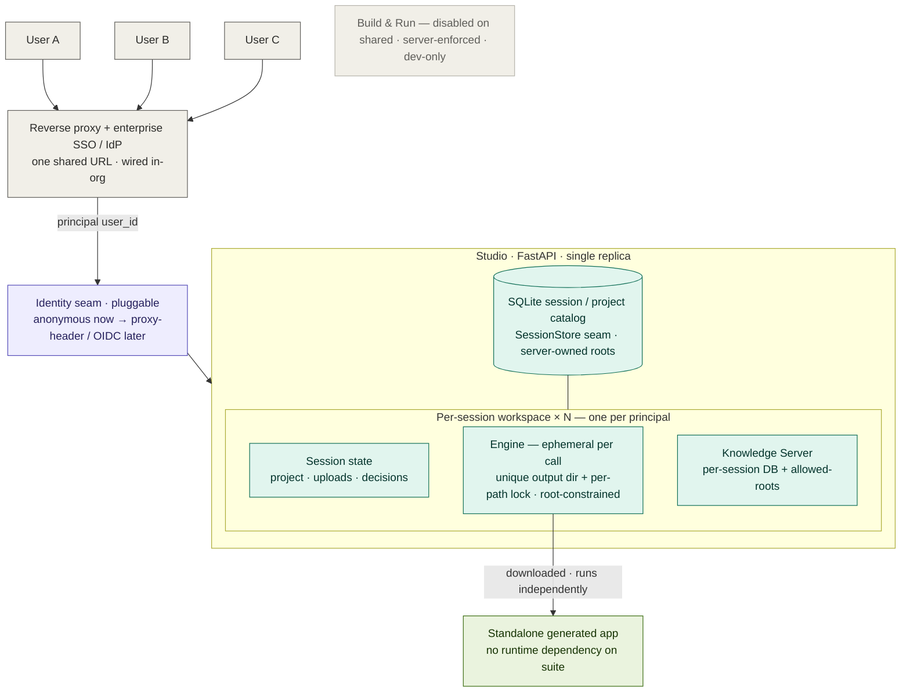

# Multi-session / multi-user architecture — suite design

**Status:** Merged baseline (PR #200, on `main`). v3 folds the suite blind-spot findings
(PR #235) into phases P2–P6 — see §14.
**Scope:** Studio-led, suite-scoped (Studio + Engine + Knowledge Server)
**Owner track:** Multi-session / multi-user (new strategic track; supersedes parked
`studio-s1b-catalog` and `D2 SSO/RBAC`)
**Audience:** Suite maintainers and the in-org team that will operate the shared
deployment after handover.

> This is a design doc, not an implementation. It settles the architecture and the
> cross-component decisions, then defines phased PRs. Line citations are as-of-review
> and are re-confirmed when each phase is implemented.

---

## 1. Problem

Today the suite assumes a **single local user**:

- Studio keeps **one global session** — a module-level `_session` plus one temp file
  `appbuilder_studio_session.json` (`app/services/session_store.py:13-14`). Every
  request shares it.
- Studio is plain FastAPI with **no auth, session, CORS, or CSRF middleware** and 14
  routers mounted directly (`app/main.py`).
- Engine and KS are launched **per invocation** as subprocesses with paths/env chosen
  by Studio.

The realistic enterprise deployment is a **shared service**: a common URL behind a
reverse proxy + enterprise SSO, serving many concurrent users. On that model the single
global session is a correctness bug (users clobber each other) and a data-isolation
hole (one user can see another's in-flight work and indexed documents).

**Goal of this track (pre-handover):** make the suite safe and correct for a shared,
multi-session deployment, and ship a *ready-to-implement* identity seam — without
building the parts that only exist inside the org (the IdP itself, RBAC policy, HA).

**Framing the maintainer set:**

- SSO/IdP **wiring** is an in-org activity (the IdP only exists inside the org). We ship
  the **seam**, not the wiring.
- **Multi-session isolation** (concurrent sessions don't clobber each other; anonymous
  token now) is buildable **without** auth and is the high-value pre-handover deliverable.
- **Multi-user** (per-identity persistence / RBAC) needs identity = auth. We build the
  seam now and bind it to the IdP later.

---

## 2. Decisions (locked)

These were debated with the maintainer and Codex and are locked. Detail and grounding
for each are in §7.

| # | Decision | Choice (locked) |
|---|----------|-----------------|
| (a) | Subprocess model | **Per-session isolation.** KS runs **per session**; Engine is invoked **ephemerally per call**. |
| (b) | KS cross-tenant isolation | **Per-session KS DB** (own DB path + allowed-roots). Shared-KS-with-tenant-ACLs deferred (not foreclosed — §5.1). |
| (c) | Engine concurrency | **Verify, don't rebuild** (gating test) + Studio enforces a **unique output dir per job** and a **per-output-path generation lock**. |
| (d) | Session-state storage | **SQLite catalog** behind a `SessionStore` seam (persistence, no versioning UX). The seam lands ahead of the SQLite backing; **no file-per-session backing**. |
| (e) | Build & Run on shared host | **Disabled by default on shared, server-enforced** (dev-only). Real sandbox (containers / off-host runner) deferred. |
| seam | Identity binding | **Pluggable identity seam.** Anonymous per-session token now → **proxy-header** primary (explicit trusted-proxy mode) / OIDC optional later. |
| audit | Auth/audit & ownership | **Durable Studio sink shipped.** Shared mode defaults to a separate SQLite audit database; local mode defaults to no-op. Attribution remains anonymous-session-level until identity adapters are wired. |

**Deployment contract (the pivotal decision):** pre-handover Studio is a **shared
authoring service with Build & Run disabled** (server-enforced) on the shared deployment,
run as a **single replica**. This keeps multi-tenant code execution out of the shared
host and bounds the security and storage scope. The named operator switches that realize
this contract are consolidated in §6.7.

---

## 3. Target architecture

End-to-end, many users on a common URL:



**Flow:**

1. Concurrent users hit one Studio URL.
2. A reverse proxy + enterprise SSO authenticates each request and yields a principal
   (`user_id`). *(In-org wiring; we ship the seam.)*
3. The **identity seam** resolves the current principal. Anonymous per-session token
   today; bound to the proxy/IdP later. Everything downstream depends only on the seam.
4. The principal keys a **per-session workspace** (replaces the global session). The
   workspace holds that user's project, uploads, and decisions, on a **server-owned**
   filesystem root.
5. Within the session: author/ingest → suggest via a **per-session KS** (own DB +
   allowed-roots) → generate via the **Engine** (ephemeral per call, isolated output
   dir, root-constrained) → optional build & run *(dev-only; disabled + enforced on
   shared)*.
6. Each generated app is **standalone** — zero runtime dependency on the suite
   (unchanged invariant).

**Isolation boundaries:** SSO identity at the edge · per-session Studio state ·
per-session runtime resources (output dirs, KS DB, allowed-roots, dev ports) · Engine/KS
invoked per session.

---

## 4. Session model

### 4.1 Request context and the identity seam

A small, pluggable identity layer (the parts of `D2 SSO/RBAC` that are buildable now):

```
Principal            = { user_id, display_name?, source: "anonymous"|"proxy"|"oidc", claims: {...} }
IdentityProvider     = interface: resolve(request) -> Principal
get_current_principal(request) -> Principal     # FastAPI dependency / middleware
```

Adapters:

- `AnonymousSessionIdentity` (**now**): issues a signed, opaque per-session token in a
  cookie — `HttpOnly`, `Secure`, `SameSite=Lax`, bounded expiry, rotation on renewal.
  One principal per browser session. No auth required; gives true multi-session
  isolation today.
- `ProxyHeaderIdentity` (**primary later**): trusts an identity header (e.g.
  `X-Forwarded-User` / signed assertion) **only** in an explicit trusted-proxy mode
  (`EDGEFORGE_STUDIO_AUTH_MODE=proxy`, §6.7) and only from the trusted,
  SSO-terminating proxy; direct-to-Studio requests carrying the header are rejected
  (§6.1).
- `OidcIdentity` (**optional later**): Studio runs the OIDC client itself.

The rest of Studio never branches on auth mode — it calls `get_current_principal()`.
This is the "ready-to-implement identity skeleton": switching from anonymous to SSO is
an adapter swap + config, not a code rewrite.

There is **no middleware layer today** (`app/main.py` mounts routers directly), so the
identity/session/CSRF middleware is greenfield — added without disturbing existing route
logic. Secure-cookie posture and CSRF (§6.2) are part of this seam and land with it (P1),
not as post-import hardening.

### 4.2 SessionStore seam + SQLite catalog

Replace the global `_session` / temp-file store (`app/services/session_store.py`) with a
`SessionStore` interface, backed by a **SQLite session/project catalog**:

```
SessionStore interface:
  get_or_create(principal) -> Session
  load(session_id) / save(session) / reset(session_id)
  list_projects(principal) ; get_project / save_project ; delete_project

SQLite tables (initial):
  sessions(session_id PK, principal_id, created_at, last_seen_at, workspace_root)
  projects(project_id PK, principal_id, session_id, name, state_json, created_at, updated_at)
```

Rationale (decision d): the dominant cost is **re-keying every route to resolve its
session from the request context** — that cost is identical whether the backing store is
a file or SQLite, so we pay it once against the catalog and get persistence and a future
external store (for HA) "for free." Project files (uploads, manifests, generated output)
live under a **server-owned** `workspace_root` per session, never a user-supplied path.

**Phasing (per Codex):** the `SessionStore` *interface* lands first (P1), backed by the
existing single-anonymous-principal default so there is no behavior change; the **SQLite
backing + router re-keying + server-owned `workspace_root`** land next (P2). We never
ship a file-per-session *backing* — the interim backing is the existing default, and the
catalog is the first real backing. Rich project versioning UX remains deferred (§10).

**Multi-replica caveat (important):** the SessionStore seam keeps an external store
*possible*, but it is **necessary, not sufficient** for HA. Beyond the catalog, the
per-session `workspace_root` filesystem and the in-process per-output-path generation
lock (§5.2) are also replica-bound. Going multi-replica requires **both** an external
session/store **and** either sticky sessions (proxy affinity) or a shared/network
workspace volume + externalized lock. Pre-handover Studio runs as a **single replica**
(§10); the seam does not by itself make Studio replica-safe.

---

## 5. Per-session resource isolation

### 5.1 Knowledge Server — per-session DB (decision a, b)

Studio already parameterizes KS per subprocess: `KSClient(allowed_roots, db_path)` and
the `ks_client()` context manager set `EDGEFORGE_KS_DB_PATH` and
`EDGEFORGE_KS_ALLOWED_ROOTS` per child (`app/integrations/ks_integration.py:37,369,394-395`).
KS reads those (`knowledge_server/server.py:47`, `knowledge_server/safety.py:17`).

**Change (Studio-only, lands P4):** launch each session's KS with a **session-scoped DB
path** (under the session `workspace_root`) and **session-scoped allowed-roots**. That
makes the cross-tenant read structurally impossible: `search_across_projects` reads all
projects when `project_ids` is omitted (`knowledge_server/storage/database.py:1063`) —
but a session's KS DB only contains that session's projects, so "all projects" is "this
user's projects." Cross-*project* reuse within a session is preserved; cross-*user* reuse
is intentionally dropped.

Note today's KS workspace is keyed by `project_id` (a per-project UUID), under a shared
temp root `tempfile.gettempdir()/edgeforge-studio-ks` (`app/services/ks_workspace.py:12,55`),
**not** by principal/session. P4 must re-key the workspace identity to include the
principal/session and relocate it under the server-owned `workspace_root` (also a
retention requirement — §6.6).

**This is a deferral, not a dead end:** the per-session KS DB-path / allowed-roots seam
(`ks_integration.py`) is the migration point for a later tenant-scoped *shared corpus* —
that path would add a `tenant_id` dimension to the schema plus a tenant-scoped
replacement for unrestricted `search_across_projects` (the model in §7(b)). Out of scope
for this track, but kept open by the seam.

**KS internal change: none required** for the per-session model.

### 5.2 Engine — ephemeral per call, isolated + locked (decision a, c)

The Engine is stateless per invocation and already takes `manifest_path` / `output_dir`
per call (`appbuilder/mcp/tools/generation.py:59`); the MCP path root-checks them
(`generation.py:118`). It writes files under `output_dir` with **no locking**
(`appbuilder/generation/engine.py:299`), so two concurrent generates into the **same**
output dir would race/overwrite.

**Changes (Studio-owned, across P3/P4):**

1. **Unique output dir per job** under the session `workspace_root` (server-owned, not
   user-supplied).
2. A **per-output-path generation lock** so a single user's double-submit can't race the
   same path.
3. **Prefer the root-constrained MCP path** in shared mode. Today `run_generate` falls
   back to the CLI with `_env_with_repo` (PYTHONPATH only — **not** root-constrained)
   when MCP is unavailable (`app/integrations/appbuilder_integration.py:330-352,539`).
   In shared mode the CLI fallback must be either disabled or made root-constrained with
   server-owned paths (§6.3).
4. **Allowed-roots fail-closed (cross-repo — blind-spot F1, PR #235).** The Engine MCP
   today fails *open*: `_allowed_roots()` falls back to `[Path.cwd(), _repo_root()]` (the
   shared Engine install) when `EDGEFORGE_MCP_ALLOWED_ROOTS` is unset
   (`appbuilder/mcp/tools/generation.py`), and Studio's `_mcp_env` *always* passes the
   shared Engine `repo` itself as an allowed root (`appbuilder_integration.py:469`) — so in
   shared mode a session could resolve `output_dir`/`manifest_path` inside the Engine tree.
   Fix (shared-mode-gated, local unchanged): **Engine** (Engine thread) fails closed —
   require explicit roots, drop the cwd/repo fallback; **Studio** (this thread) stops
   passing `str(repo)` in `_mcp_env`, passing only the per-session workspace roots (the repo
   stays `PYTHONPATH`-only). Lands P3, verified P4.

**Engine internal change:** the **allowed-roots fail-closed default (F1, above) is a real
Engine change** (Engine thread); beyond that none is expected. A concurrency/reentrancy
verification is **required (not optional)** before shared deployment — test that two
concurrent generates with distinct output dirs don't interfere (no shared mutable global /
CWD / temp). No obvious shared mutable generation state was found, but per-job isolation
(unique output roots + the per-output-path lock) is mandatory regardless, because the
Engine writes directly into `output_dir` with no lock (`engine.py:299`). A shared
long-lived Engine MCP — which this design avoids — would need more.

> **Status — merged (2026-06-17).** Items 1–4 and the F1 fail-closed change above are
> **implemented and merged**, two-sided: Studio root-constrains **every** shared-mode
> Engine call and **forces MCP** for generate (no env-less CLI fallback), and `_mcp_env`
> no longer passes the Engine `repo` as an allowed root (PR #217); the Engine **fails
> closed** on unset / out-of-root roots (Engine PR #248); proven by the L4 fail-closed
> smoke (#218). The present-tense "today …" wording above is the **pre-implementation
> grounding** that motivated the fix — see §8 *Status* and the G8/deployment docs for
> current state.

---

## 6. Security & data-governance design

The shared deployment introduces multi-tenant concerns beyond the (already-done)
import-gate work. Each item below is grounded in current code.

### 6.1 Edge identity & proxy trust

- `ProxyHeaderIdentity` must trust the identity header **only** in the explicit
  trusted-proxy mode (§6.7) and **only** when the request arrives from the trusted proxy
  (validate a shared secret / mTLS / network path); Studio must **reject** identity
  headers on any other path. Direct-to-Studio bypass must be impossible.
- Bind the session to the principal; rotate the session token on privilege change.

### 6.2 Session cookies & CSRF (seam-scoped, lands P1)

- Secure session cookie: `HttpOnly`, `Secure`, `SameSite`, expiry, rotation (none exist
  today — `app/main.py` has no session middleware).
- **CSRF protection** for browser-authenticated, state-changing POSTs — which is the
  moment routes become session-scoped. "No CORS" is **not** CSRF protection. Add a CSRF
  token (double-submit or synchronizer) to the state-changing routers.
- These are **identity-seam concerns, not deferrable hardening**: they ship with the
  seam / session-scoped POSTs (P1, binding to P2), not post-import.

### 6.3 Server-owned paths (replace user-supplied paths)

- Today Studio Step 1 stores user-supplied `output_path` and `appbuilder_repo_path`, and
  the Engine CLI fallback / `run_assess` / `validate_manifest` run with `_env_with_repo`
  (PYTHONPATH only) on those paths (`appbuilder_integration.py:237,287,294,349,539`).
  Acceptable locally; risky shared.
- In shared mode: **server owns** all workspace/manifest/output roots (derived from the
  session `workspace_root`); user-supplied filesystem paths are not honored. The Engine
  repo path is operator config, not per-request input. (Lands P2; security-gate
  consequences in P3.)
- This server-owned, per-session **Engine-invocation path** is also where the
  Regenerate/Maintain track (Engine PR #239 §3/§9) requires the dry-run Change Plan to be
  invoked from — build it path-clean so that consumer drops in (§15).

### 6.4 SSRF (suite-scoped, mostly Engine)

- Studio's Step 2 URL fetch is **guarded** by `app/services/openapi_fetch_guard.py`,
  merged to main via PR199 (commits `6a70cbf`, `3d00106`; merge `3a87f8e`). It enforces
  an http/https scheme allowlist, an optional host allowlist
  (`EDGEFORGE_STUDIO_OPENAPI_FETCH_ALLOWED_HOSTS`), blocks private/link-local/multicast/
  reserved IPs, and re-validates **every redirect target** (`validate_openapi_fetch_url:67`,
  `fetch_url_with_policy:102`); `openapi_service.fetch_openapi_from_url` uses it
  (`openapi_service.py:25`).
- This track **hardens the existing on-main guard** (it does not build one). Two gaps for
  shared mode:
  1. The guard currently **allows loopback / `localhost`** (`openapi_fetch_guard.py:82,96`)
     — fine locally, an SSRF vector on a shared host. Add a shared-mode policy that
     disallows loopback and (optionally) enforces allowlist-only (§6.7).
  2. The **Engine** fetch is **unguarded**: `appbuilder/ingestion/openapi_fetcher.py:16`
     does `urlopen(url, timeout=10)` (no allowlist, follows redirects). It is reachable
     from Studio via `run_assess --swagger <user-url>` (`appbuilder_integration.py:287`,
     `export.py:520`). Fix by having Studio fetch the spec through its own guard and pass
     **content/file** to the Engine (so the Engine never fetches user URLs), or add an
     equivalent guard to the Engine fetch path. Preferred: Studio-fetch-and-pass.

  This is `studio-ssrf-guard` extended from a Studio-only item to a **suite** item, and
  it lands as an **early shared-mode security gate (P3)**, not bundled with later work.

### 6.5 Build & Run posture (decision e) — disabled + server-enforced on shared

Build & Run executes generated Spring Boot code on the Studio host: it runs
`java -jar … --server.port=<port>` via `subprocess.Popen` (`app/services/build_run_service.py:188`),
tracks PIDs in an **in-process** registry (`build_run_service.py:21`), and picks a port
from `18080–18120` bound to `127.0.0.1` (`build_run_service.py:22-23`). That is local-dev
behavior: multi-tenant code execution, no quotas/network policy, and an in-process
registry that won't survive multiple replicas.

- **Local mode (`EDGEFORGE_STUDIO_SHARED_MODE=false`, the default) is unchanged:** Build
  & Run remains enabled and behaves exactly as today — this gate and all shared-mode
  secure defaults apply **only** when shared mode is on. Local single-user dev/test is
  not affected by this track.
- **Shared deployment: disabled by default and server-enforced.** The
  `EDGEFORGE_STUDIO_BUILD_RUN_ENABLED` flag (§6.7) must **enforce** the disabled posture
  server-side — the `/export/build` and `/export/run` routes (and `build_run_service`)
  **refuse to execute** when off, returning a 4xx — **not** merely hide the panel. Today
  `build_run_enabled` is purely a UI signal (`export.py:327` → the template's hidden
  class), and the build/run POST routes (`export.py:568`, `export.py:597`) are **ungated**
  — so this gate is **net-new server-side behavior**, not a config rename.
- When enabled (dev): per-session port + per-session workspace; per-session port is
  routing, **not** a safety boundary. The in-process PID registry is dev-only/non-HA.
- The real fix — disposable containers / off-host ephemeral workers with quotas, network
  policy, log isolation, and port routing — is a **deferred track**, not built here.
  Per-session runtime isolation (§5) must **not** be read as making Build & Run a normal
  shared-service feature.

### 6.6 Data governance, lifecycle, ops

**Retention / cleanup (P6b implemented).** Idle-session retention now purges expired
catalog rows and cleans session workspaces from the server-owned workspace base. Reset
cleans volatile workspace contents in place. Explicit last-project delete removes the
entire workspace, including durable artifacts.

| Artifact class | Where today | Note |
|---|---|---|
| Session state | SQLite catalog | idle-session TTL → `sessions` row purge; `projects` cascade via FK |
| Uploads / manifests / generated packages | session `workspace_root` (`output/`) | removed on idle purge and reset |
| Export ZIPs | session `workspace_root` (`exports/`) in shared mode | removed on idle purge and reset |
| KS DB + workspace | session `workspace_root` (`ks/`) | removed on idle purge and reset after managed KS clients are stopped |
| Build & Run logs + temp | `tempfile.gettempdir()/edgeforge_studio_build_run` | local-dev-only because Build & Run is server-disabled by default in shared mode; out of P6b scope |
| Durable managed project artifacts (regen baseline/package copy — Engine #239) | session `workspace_root` (`managed-artifacts/`) | **Exempt from idle/session TTL and reset** — volatile siblings are cleaned, but the session/project handle remains until explicit project delete; else regenerate loses its baseline (Engine #239 §4/§6; §15) |

Retention cleanup asserts every target is inside `state_dir/workspaces/` before removal.
The **durable managed artifact** class above is exempt from idle/session TTL and reset.
When `managed-artifacts/` exists, idle retention cleans volatile sibling files but keeps the
session/project catalog rows so a later explicit project delete still has a handle to remove
the durable area. Purge durable artifacts only on explicit project delete, so the
Regenerate/Maintain baseline survives multi-session cleanup (§15).

**Quotas (P6a implemented).** The baseline file cap is
`EDGEFORGE_STUDIO_MAX_UPLOAD_BYTES` (default 50 MiB), with a fixed 1 MiB multipart
envelope allowance (51 MiB total by default) enforced for Step 2 OpenAPI, project-open,
and Knowledge Workspace uploads before normal request processing where possible and
while streaming otherwise. The same local/shared policy requires multipart envelopes
and allowlisted filename extension/file-part MIME pairs; MIME remains client metadata,
so existing parsers remain the content authority. P6a adds additive,
non-destructive guards for (a) **per-session disk**, (b) **project count** per
session/principal, (c) **KS DB size** cap (storage, distinct from the
subprocess-concurrency cap), (d) **KS subprocesses** concurrency cap, and (e)
**subprocess wall-clock limits** for validate/assess/generate/build. Over-limit
requests fail closed with clear 4xx responses where a route is involved; P6b
retention remains the destructive cleanup slice.

**Audit events (current Studio implementation).** Capture, with principal + session IDs:
project open, project save, export, generate, and **build-run attempts (including the
disabled-on-shared rejection as an auditable "build-run-disabled attempt")**. Event shape:

```
AuditEvent = { event_type, principal.user_id, session_id, project_id?, timestamp, outcome }
```

Shared mode defaults to a separate durable SQLite sink with bounded retention and a
sanitized degradation banner; local mode defaults to no-op. Operator status/export is
local and read-only. No browser audit or health API is exposed.

**KS subprocess lifecycle (lands P6):** lazy spawn on first use (KA is OFF by default, so
most sessions never spawn KS), idle reap, concurrency cap. P6a implements this as a
Studio lifecycle wrapper over the low-level KS integration; KA OFF still spawns and reaps
nothing.

**Shared-mode request resource controls (PR-3b implemented).** A fixed method/path
registry applies process-local, in-memory controls to whole costly Engine, KS,
upload/inspection, and archive requests. Guarded URL work uses the same Class B limits
through both the registry-controlled Step 2 URL ingest and a named request-scoped
passthrough fetch seam: `/passthrough/describe-spec` URL mode and each URL-backed
downstream target in `/passthrough/save` acquire one Class B slot. Each class has an
independent sliding-window per-principal rate budget and immediate principal/process
concurrency counters; full capacity returns `429` with `Retry-After` and never queues.
The limiter runs after request context and non-deferred CSRF, while the pre-multipart
upload policy runs outside it, so early rejected upload envelopes consume no capacity.
Deferred multipart-CSRF rejections can consume rate budget but release all acquired
concurrency permits. Text-only saves, safety operations (`/export/stop`,
`/export/reset`, and `/export/run-status`), artifact reads, and wizard/Knowledge page
renders are deliberately unthrottled; existing KS subprocess caps and timeouts remain
their protection.

The limiter is installed with a constant-time local-mode bypass: no route classification,
principal key derivation, lock, or in-memory state mutation occurs locally. Shared mode is
single replica; state resets on process restart and is capped at 10,000 inactive/LRU
evictable principal/class entries. Anonymous signed-cookie principals provide fairness and
accidental-overload protection only, not durable anti-abuse identity, because clearing a
cookie creates a new principal and rate history. Process-wide concurrency caps remain the
hard per-process protection until real identity/RBAC and a multi-replica control design
exist.

**Backups / HA:** out of scope (single-replica — §10); the `SessionStore` seam keeps the
external-store path open (but see the §4.2 multi-replica caveat).

### 6.7 Configuration — shared-mode feature flags

One named operator contract so the shared-mode posture is explicit, not scattered. Keep
the `EDGEFORGE_STUDIO_*` prefix already used on main; Codex's short names are listed as
aliases. Defaults shown are for `EDGEFORGE_STUDIO_SHARED_MODE=true`.

| Flag | Values | Default (shared) | Effect |
|---|---|---|---|
| `EDGEFORGE_STUDIO_SHARED_MODE` (alias `STUDIO_SHARED_MODE`) | bool | `false` | Master switch; when true the secure defaults below apply. |
| `EDGEFORGE_STUDIO_AUTH_MODE` (alias `STUDIO_AUTH_MODE`) | `anonymous` \| `proxy` | `anonymous` | Selects the §4.1 identity adapter; `proxy` = trusted-proxy-header mode (§6.1). |
| `EDGEFORGE_STUDIO_BUILD_RUN_ENABLED` (alias `BUILD_RUN_ENABLED`) | bool | `false` | Server-enforced Build & Run gate (§6.5). |
| `EDGEFORGE_STUDIO_OPENAPI_FETCH_MODE` (alias `OPENAPI_URL_FETCH_ENABLED`) | `disabled` \| `allowlist` \| `open` | `allowlist` | URL-fetch policy (§6.4), paired with `EDGEFORGE_STUDIO_OPENAPI_FETCH_ALLOWED_HOSTS`; `allowlist` also disallows loopback. |
| `EDGEFORGE_STUDIO_MAX_UPLOAD_BYTES` | integer bytes | `52428800` | Per-file upload cap. The three protected multipart routes allow a fixed additional 1 MiB for envelope overhead and reject invalid envelopes/types before parsing; client-declared MIME is not content validation. |
| `EDGEFORGE_STUDIO_RATE_<CLASS>_MAX`, `..._WINDOW_S`, `..._CONCURRENCY_PRINCIPAL`, `..._CONCURRENCY_PROCESS` (`CLASS=A,B,C,C2,D`) | non-negative integers | See deployment model | Shared-mode request resource controls. A/B/C/C2/D defaults are respectively 6/20/30/120/60 per 300 seconds, with principal/process caps 1/2, 2/6, 2/6, 4/12, and 4/12. A zero disables only that one dimension. |
| `EDGEFORGE_STUDIO_MAX_SESSION_DISK_BYTES` | integer bytes | `5368709120` | Per-session workspace quota; over-limit package/upload actions are rejected, not deleted. |
| `EDGEFORGE_STUDIO_MAX_PROJECTS_PER_PRINCIPAL` | integer count | `100` | Principal-scoped project catalog cap. |
| `EDGEFORGE_STUDIO_MAX_KS_DB_BYTES` | integer bytes | `1073741824` | Per-session Knowledge Workspace DB size cap. |
| `EDGEFORGE_STUDIO_MAX_KS_SUBPROCESSES` | integer count | `8` | Process-wide cap for Studio-managed KS subprocesses. |
| `EDGEFORGE_STUDIO_KS_IDLE_TTL_SECONDS` | integer seconds | `1800` | Idle TTL before Studio reaps a managed KS subprocess. |
| `EDGEFORGE_STUDIO_SESSION_IDLE_TTL_SECONDS` | integer seconds | `86400` | Idle TTL before Studio purges expired session catalog rows and volatile workspace contents. |
| `EDGEFORGE_STUDIO_ENGINE_VALIDATE_TIMEOUT_SECONDS` | integer seconds | `15` | Manifest validation subprocess timeout. |
| `EDGEFORGE_STUDIO_ENGINE_ASSESS_TIMEOUT_SECONDS` | integer seconds | `30` | Engine assess subprocess timeout. |
| `EDGEFORGE_STUDIO_ENGINE_GENERATE_TIMEOUT_SECONDS` | integer seconds | `120` | Engine generate subprocess fallback timeout. |
| `EDGEFORGE_STUDIO_BUILD_TIMEOUT_SECONDS` | integer seconds | `600` | Local generated-app build timeout. |

When `EDGEFORGE_STUDIO_SHARED_MODE=false` (the default — i.e. local dev/test on your own
machine), **none** of the secure defaults apply and Studio behaves as the single-user
local tool it is today, Build & Run included. §6.4 and §6.5 cross-reference this table so
scattered prose resolves to one contract.

---

## 7. Decisions in detail (with Codex reconciliation)

**(a) Subprocess model — per-session KS, ephemeral per-call Engine.**
Clean isolation with ~zero internal Engine/KS change; Studio passes isolated paths/env
per invocation, which `_mcp_env` (`appbuilder_integration.py:466`) and `_ks_env`
(`ks_integration.py:394-395`) already do. The Engine is stateless and path-driven, so a
short-lived per-job process is simpler and safer than a long-lived per-session Engine.
Guardrail: in shared mode prefer the root-constrained MCP path and/or root-constrain the
PYTHONPATH-only CLI fallback (§5.2, §6.3). *Codex: agree.*

**(b) KS cross-tenant isolation — per-session KS DB.**
Structurally removes the `search_across_projects` cross-tenant read
(`database.py:1063`). Tradeoff: keeps cross-project reuse within a session, drops
cross-user reuse. Shared-KS-with-tenant-ACLs deferred (not foreclosed — §5.1).
*Codex: agree; a shared KS would need a real `tenant_id` model + a constrained
replacement for unrestricted portfolio search — hence we don't share.*

**(c) Engine concurrency — verify + isolate + lock.**
Keep "verify, don't rebuild," and add a unique output dir per job + a per-output-path
generation lock (concurrent same-path writes overwrite — `engine.py:299`). Ephemeral
per-call + distinct output dirs *should* make cross-job concurrency safe, but this is
confirmed only by the P7 reentrancy test — **verify, don't assume** (§11); per-job
isolation is mandatory, not optional.
*Codex: agree only if Studio enforces isolation (unique roots, generation lock) and does
not call it a non-issue; adopted.*

**(d) Session storage — SQLite catalog behind a seam.**
Re-keying routes is the dominant cost (`session_store.py:13`), identical for file or DB,
so back the `SessionStore` with SQLite (persistence now; versioning deferred; external
store later for HA). The seam lands ahead of the SQLite backing (P1 → P2); we never ship a
file-per-session *backing*, so "skip the file-per-session intermediate" means skip the
backing, **not** the interface. P1 ships the seam alone (single-anonymous default, no
behavior change); **P1+P2 together are the first shared-URL-credible state** (SQLite
backing + per-session route re-keying), and rich versioning UX stays deferred (§10).
*Codex: agree DB-backed catalog is the target; refine to phase interface-first /
catalog-second and not call pure file-per-session a viable end state — adopted.*

**(e) Build & Run — disabled + server-enforced on shared (dev-only).**
Per §6.5: off by default, enforced server-side at the build/run routes (net-new — they
are ungated today), sandbox deferred.
*Codex: agree disable-by-default; push back that it must be enforced not merely hidden,
that per-session port is not sufficient safety, and that the in-process PID registry is
not shared-safe — all adopted.*

**Identity seam — pluggable, proxy-header primary.**
Anonymous now → proxy-header later (SSO terminates at the proxy; trusted-proxy mode +
no-bypass per §6.1), OIDC optional. Secure-cookie posture and CSRF are **seam-scoped**
and land with the session-scoped POSTs (P1/P2), not post-import hardening.
*Codex: agree; emphasizes explicit trusted-proxy trust + no bypass, and that CSRF/cookie
posture belongs to the seam — adopted.*

**Audit & ownership — durable Studio sink implemented.**
Principal, project ownership, and audit hook-points persist the locked `AuditEvent`
shape to a separate SQLite database by default in shared mode. Attribution remains at
anonymous-session level until enterprise identity wiring. Events are enumerated in
§6.6.
*Codex: lists auth/audit seam as a must-have before common-URL deployment — the structural
seam ships now; the org completes the pipeline.*

---

## 8. Phasing (proposed PRs)

Each phase is an independently reviewable PR (build → PR not merged → Codex review → fix →
maintainer merges). Ordering puts **shared-mode security gates before per-session runtime
exposure** (Codex), and lands the `SessionStore` interface ahead of its SQLite backing.

> **Status (2026-06-17).** **P1–P7 are merged** (P1 #201; P2 #204/#205/#207/#208; P3 #209;
> P4 #211; P5 #212; P6 #213/#214; P7 #216), with the **L2** two-session smoke (#210) and the
> **L4** cross-repo smoke (#215) green. The **F1 allowed-roots fail-closed** isolation is
> **closed two-sided** — Studio root-constrains every shared-mode Engine call (#217) and the
> Engine fails closed on out-of-root paths (Engine #248), proven by the L4 fail-closed
> negatives (#218). **P8 docs merged (#219).** The **L5** acceptance gate is **GREEN** (suite
> orchestrator at pinned SHAs) — enterprise-ready baseline **v4.0.0**. The **regen-preview UX**
> (fast-follow, feature-flagged; renders the Engine Change Plan — §15 — never recomputes the
> diff) is **feature-complete → v4.1.0**: Slice 1 binding #222, Slice 2 render #223, Slice 3
> approve→apply #226, with de-risk smokes #224/#225. Default **OFF**
> (`EDGEFORGE_STUDIO_REGEN_PREVIEW_ENABLED`). The **L5 regen-preview approve→apply addendum**
> has landed in #228; remaining: the **v4.1.0** baseline/tag step.

| Phase | Goal | Key changes (file:symbol) | Repos | Size |
|------|------|---------------------------|-------|------|
| **P0** | This design doc + Codex review | `docs/multi-session-architecture-design.md` | Studio | S |
| **P1** | Identity & request-context seam (+ SessionStore interface, CSRF/cookies) | `Principal`, `IdentityProvider`, `AnonymousSessionIdentity` (signed cookie: HttpOnly/Secure/SameSite/expiry/rotation), `get_current_principal`, middleware in `app/main.py`; introduce `SessionStore` interface backed by the single-anonymous default (no behavior change); CSRF token + secure-cookie posture (seam-scoped) | Studio | M |
| **P2** | Per-session state — SQLite catalog backing + route re-key | back `SessionStore` with SQLite (replace `app/services/session_store.py`); re-key all 14 routers to resolve session from request context; server-owned `workspace_root` (§6.3); **carry-forward from P1 review: native-form CSRF for the 5 native `<form method=post>` POSTs (`/project/save`, `/project/open`, `/` Step 1, `/knowledge/upload`, knowledge form) — convert to fetch+header or a route-layer form-body token** | Studio | **L** |
| **P3** | Shared-mode security gates (land before runtime) | Build & Run server-enforced disable gate at `/export/build` + `/export/run` (refuse when off, not just hide — `export.py:568,597`); SSRF shared-mode hardening of the on-main guard (no-loopback/allowlist) + Studio-fetch-and-pass for assess (`appbuilder_integration.py:287`); prefer root-constrained MCP / disable-or-root-constrain CLI fallback (`appbuilder_integration.py:539`); **allowed-roots fail-closed (F1): Studio `_mcp_env` drops the shared-repo root [here] · Engine `_allowed_roots` fail-closed [Engine thread]**; flag matrix (§6.7) | Studio (+ Engine thread) | M |
| **P4** | Per-session runtime isolation (KS + Engine) | session-scoped `EDGEFORGE_KS_DB_PATH`/`_ALLOWED_ROOTS` under `workspace_root` + re-key KS workspace by principal (`ks_integration.py`, `ks_workspace.py`); unique per-job output dir + per-output-path lock; **verify Engine fail-closed roots (F1)** | Studio (verify Engine/KS) | M |
| **P5** | Audit & ownership hooks | project ownership (project↔principal); structured `AuditEvent` (§6.6) at project open/save/export/generate/build-run incl. disabled attempts; **Studio now uses durable SQLite by default in shared mode and no-op locally**; Engine MCP + KS server logging remain separately owned cross-repo surfaces | Studio (+ Engine/KS threads) | M |
| **P6** | Lifecycle / ops | per-artifact retention/cleanup (relocate temp-rooted classes — §6.6); quotas (disk/project-count/KS-DB-size/subprocess-time); KS subprocess lazy-spawn/idle-reap/caps; **KS reliability cluster (DB-open integrity · per-call DDL · purge-scrub retry · health) [KA/KS thread]** | Studio (+ KA/KS thread) | M |
| **P7** | Concurrency & isolation tests | Engine reentrancy (concurrent generate, distinct dirs); KS no-cross-tenant; session-isolation e2e; proxy-bypass + CSRF tests; Build & Run gate-enforced test | Studio (+ Engine test) | M |
| **P8** | Docs rewrite | deployment model + `docs/security-boundary-map.md` (G8) + `docs/compliance-and-portability.md` (G7) for shared multi-session; **unblocks the held suite assembly** | all 3 (docs) | M |

**Dependencies:** P1 → P2 → {P3 gates, P4 runtime}; P3 (shared-mode gates) must land
**before or with** P4 (runtime exposure), not after. CSRF (P1) binds to the session-scoped
POSTs introduced in P2. P5–P6 depend on P2/P4; P7 after the surfaces exist; P8 last.

`studio-s1b-catalog` is realized by P2; `D2 SSO/RBAC` is realized (structurally) by P1 +
P5; `studio-ssrf-guard` (suite-scoped hardening of the on-main guard) is realized by P3.
Suite blind-spot findings (PR #235) are folded into P2–P6 — see §14 for the cross-repo
ownership map.

---

## 9. Per-repo impact

- **Studio — substantial.** Session store, route session-keying, server-owned workspace
  filesystem, identity/CSRF middleware, KS per-session launch, Engine per-job
  isolation/locking, Build & Run gate, audit/ownership, lifecycle/ops. This is where the
  track lives.
- **Engine — small, owned by the Engine thread.** Unique/server-owned output roots, no
  shared output dirs, prefer root-constrained MCP, no unsafe CLI fallback in shared mode.
  Explicit Engine changes from the blind-spot review: **`_allowed_roots` fail-closed
  default (F1)** and **structured MCP logging (F2)** — plus a concurrency/reentrancy
  **test** and the SSRF fix (Studio-fetch-and-pass, or a guard on `openapi_fetcher.py`). No
  core generator change. *The minimal claim holds only for the per-session-KS-DB +
  ephemeral-Engine model; a shared KS or shared Engine MCP would need tenant work /
  concurrency proof + path locks respectively.*
- **KS — small, owned by the KA/KS thread.** No internal change for the per-session model
  itself, but the blind-spot review adds **structured server logging (F2)** and the
  **reliability cluster** (DB-open integrity · per-call DDL · purge-scrub retry · health) on
  the KS side. A shared KS would require a real tenant model — **deferred, not
  foreclosed**; the per-session KS DB seam keeps that path open (§5.1).

One suite-level design doc (this) + per-repo implementation in the phased PRs. The
dangerous parts are the **boundaries between repos**, which is why this is not split into
three independent designs.

---

## 10. Non-goals (this track)

- Full SSO/IdP **wiring** (in-org; we ship the seam).
- Full **RBAC / authorization policy** (the seam carries identity; policy is in-org).
- **Multi-replica HA** / external session store. Pre-handover Studio runs as a **single
  replica**: beyond the SQLite catalog, the per-session `workspace_root` filesystem and
  the in-process generation lock (§5.2) are replica-bound, so multi-replica needs **both**
  external session storage **and** sticky sessions or a shared workspace volume +
  externalized lock (§4.2). The seam keeps the path open; it is not built here.
- **Shared knowledge corpus** with tenant ACLs — **deferred, not foreclosed**; the
  per-session KS DB is forward-compatible with a later tenant model (§5.1).
- **Production Build & Run sandbox** (containers / off-host runner) — deferred track.
- **Project versioning UX** (catalog persists; version history deferred).
- **Not deferred:** CSRF protection and secure session-cookie posture are identity-seam
  concerns (§4.1/§6.2) that ship the moment shared browser auth / session-scoped POSTs
  exist (P1, with/binding to P2) — not optional edge hardening.
- Changes beyond the paired **manifest 2.0 contract** and to the **standalone**
  nature of generated apps remain out of this design. The later coordinated
  manifest-version cut supersedes the original v1 wording without changing the
  multi-session architecture.

---

## 11. Risks & open questions

- **Re-keying surface (P2)** is the largest single change — every router currently calls
  `get_session()` directly. Mitigation: introduce `get_current_session(request)` as a
  FastAPI dependency and migrate routers mechanically; keep a single-anonymous-principal
  default so behavior is unchanged until SSO is wired.
- **KS subprocess fan-out**: one KS process per active session could be heavy. Mitigation:
  lazy spawn on first KA use (KA is OFF by default, so most sessions never spawn KS),
  idle reap, concurrency cap (P6).
- **Engine reentrancy assumption (c)**: must be verified by test (P7), not assumed.
- **Proxy-trust model (6.1)** depends on the in-org proxy; we ship a configurable trust
  boundary (`EDGEFORGE_STUDIO_AUTH_MODE`, §6.7) and bypass rejection, and document the
  operator contract.
- **Open questions for the in-org team:** (1) preferred session-token signing-key
  management and proxy identity-header format (documented as a config contract, not
  hard-coded); (2) if they ever run >1 Studio replica, decide sticky-sessions vs shared
  workspace volume vs externalized lock + session store (§4.2).

---

## 12. Verification plan

- **Isolation e2e:** two concurrent sessions; assert no state, upload, KS-result, or
  output-dir crossover.
- **KS tenancy:** `search_across_projects` in session A never returns session B's docs
  (per-session DB).
- **Engine concurrency:** parallel generates into distinct output dirs produce correct,
  non-interfering output; same-path double-submit is serialized by the lock.
- **Edge security:** identity-header bypass attempt (direct, not via proxy) is rejected;
  CSRF token required on state-changing POSTs; `openapi_fetch_guard` rejects loopback in
  shared mode; assess does not reach the Engine `urlopen` with a user URL.
- **Build & Run gate:** disabled-by-default on shared **and enforced server-side** —
  `/export/build` and `/export/run` reject when off (not merely hidden); enabling is
  explicit and dev-only.

---

## 13. Grounding index

> **Pre-implementation snapshot — not current state.** This index records the facts **as
> of design time (pre-P1)** to ground the plan. The track (P1–P7) and **F1** (#217 / Engine
> #248) have since **landed**, so several rows below are now historical — e.g. single global
> session → per-session SQLite catalog; no auth/CSRF middleware → identity seam + CSRF;
> CLI/assess/validate "not root-constrained" → root-constrained in shared mode (assess
> guarded before Engine; generate MCP-forced); Build & Run "UI-only / routes ungated" →
> server-enforced gate; KS workspace "keyed by project_id" → per-session. See §8 *Status*
> for what's merged and the G7/G8/deployment docs for current state.

| Fact | Location |
|------|----------|
| Single global session (module global + temp file) | `app/services/session_store.py:13-14` |
| No auth/session/CORS/CSRF middleware; 14 routers | `app/main.py` |
| Engine MCP env root-constraint | `app/integrations/appbuilder_integration.py:466` (`_mcp_env`) |
| CLI/assess/validate env = PYTHONPATH only (not root-constrained) | `app/integrations/appbuilder_integration.py:539` (`_env_with_repo`), used at `:237,287,294,349` |
| CLI generate fallback (user output dir) | `app/integrations/appbuilder_integration.py:330-352` |
| Hardcoded subprocess timeouts (→ quota knobs) | `app/integrations/appbuilder_integration.py:238,295,350` |
| Studio URL fetch guard (merged via PR199, merge `3a87f8e`) | `app/services/openapi_fetch_guard.py` (`validate_openapi_fetch_url:67`, `fetch_url_with_policy:102`); used by `app/services/openapi_service.py:25` |
| Studio guard still allows loopback/localhost | `app/services/openapi_fetch_guard.py:82,96` |
| Assess passes user URL to Engine | `app/routes/export.py:520`, `app/integrations/appbuilder_integration.py:287` |
| Engine unguarded URL fetch (SSRF) | `appbuilder/ingestion/openapi_fetcher.py:16` (`urlopen`) |
| KS per-child DB path + allowed-roots | `app/integrations/ks_integration.py:37,369,394-395` |
| KS workspace temp-rooted, keyed by project_id (not principal) | `app/services/ks_workspace.py:12,55` |
| Build & Run flag is UI-only today; build/run routes ungated | `app/routes/export.py:327,568,597` |
| Build & Run: in-process PID registry, port range, `java -jar` | `app/services/build_run_service.py:21,22-23,188` |
| Build & Run logs + temp root (outside workspace) | `app/services/build_run_service.py:411,93,183` |
| Export ZIP written to temp (outside workspace) | `app/routes/export.py:438` |
| Engine generate takes paths per call + root-check | `appbuilder/mcp/tools/generation.py:59,118` |
| Engine writes output with no lock | `appbuilder/generation/engine.py:299` |
| KS reads DB-path / allowed-roots env | `knowledge_server/server.py:47`, `knowledge_server/safety.py:17` |
| KS cross-project read when `project_ids` omitted | `knowledge_server/storage/database.py:1063` |
| Engine allowed-roots fail-open default (cwd + repo-root when env unset) — F1 | `appbuilder/mcp/tools/generation.py` (`_allowed_roots`, `_repo_root`) |
| Studio `_mcp_env` passes the shared Engine repo as an allowed root — F1 | `app/integrations/appbuilder_integration.py:469` |
| Engine/KS MCP servers have no structured logging; `generate_app` swallows exceptions — F2 | `appbuilder/mcp_server.py`, `appbuilder/mcp/tools/generation.py:71-77`, `knowledge_server/server.py` |
| Studio project-file migration chain short-circuits (`_migrate_v1_1_to_v1_2` jumps to current version, skipping `_migrate_v1_2_to_v1_3`) — Studio, pre-P2 | `app/services/project_file_service.py:304-314,350` |

---

## 14. Suite blind-spot findings folded into this track (PR #235)

The suite blind-spot review (Engine `docs/suite-blind-spot-review-2026-06-14.md`, PR #235)
is the frozen point-in-time record. The **actionable** detail lives here. Each item is
shared-mode-gated (local behavior unchanged) and rides a phase that already owns its
surface; ownership is split across threads, so this table prevents double-building.

| Item | Finding | Phase | Owner | Studio action |
|---|---|---|---|---|
| **F1 — allowed-roots fail-open** | Engine MCP fails open to cwd + shared repo-root when roots unset; Studio also whitelists the repo (§5.2 #4) | **P3** (verify P4) | **cross-repo** | `_mcp_env` drops `str(repo)` in shared mode; pass only per-session workspace roots |
| **F2 — no structured logging/audit** | Engine MCP + KS servers log nothing; `generate_app` swallows exceptions | **P5** | Engine thread (MCP) + KA/KS thread (KS) | Studio audit hooks (already in P5); coordinate the KS half once |
| **KS reliability cluster** | DB-open integrity · per-call DDL · purge-scrub retry · health | **P4/P6** | **KA/KS thread** | none — cross-referenced for sequencing |
| **Snapshot-migration dead-step** | `_migrate_v1_1_to_v1_2` jumps to the current version, skipping `_migrate_v1_2_to_v1_3` for 1.0/1.1 projects — fix the chain **before** adding `_migrate_v1_3_to_v1_4` (`project_file_service.py:304-314,350`) | **P2-prep (pre-P2)** | **Studio thread** | **fix the chain before P2** (standalone P2-prep PR) so persistence isn't built on it |

Engine-standalone blind-spot items (the two Engine MUSTs, the escaping cluster,
generated-app hardening) are tracked by the Engine thread as dedicated tracker rows — **not**
here, to avoid double-tracking. This track's A-group items are noted on the suite tracker's
`multi-session-multiuser` row.

---

## 15. Adjacent track: Regenerate / Maintain (Engine PR #239)

The Regenerate/Maintain track (Engine `docs/regenerate-maintain-suite-design.md`, PR #239)
is a **separate, parallel** effort that **consumes** this multi-session foundation — it is
not part of P1–P8. The Engine owns the authoritative dry-run **Change Plan** + `plan_hash`
binding; Studio later renders the plan and gates destructive items. Captured here only so the
multi-session slices stay regen-aware (Engine #239 §7 sequences the two tracks as independent):

> **Status — regen-preview MERGED (2026-06-21 → v4.1.0; flag `EDGEFORGE_STUDIO_REGEN_PREVIEW_ENABLED`,
> default OFF).** The four bullets below are now **realized**: the durable `managed-artifacts/`
> baseline (Slice 1 #222 + P6b), the per-session F1 Engine-invocation path (`run_change_plan` /
> `run_apply` via `_engine_subprocess_env`), the additive project fields (`_migrate_v1_3_to_v1_4`,
> #222), and the convergence-point UI — **Slice 2 render #223** (renders the Engine Change Plan
> verbatim; consumer-compat on `change_plan_schema_version` — rejects unknown major, tolerates
> minor) + **Slice 3 approve→apply #226** (`appbuilder apply --approved-plan-hash`; additive-only,
> drift + destructive **fail closed**; apply lock + audit). De-risk smokes: plan #224, apply #225.
> **Studio never recomputes the diff or the migration — it presents the Engine's plan and gates
> apply.** The L5 regen-preview approve→apply addendum has landed in #228; remaining: the
> v4.1.0 baseline/tag step.

- **P6 retention must exempt the managed baseline artifact.** The regen track stores a
  durable, hashed **managed copy** of the generated package + `db/schema-baseline.json` as a
  Studio-owned project artifact under `<workspace_root>/managed-artifacts/` — **never** a bare
  external path or a TTL'd workspace temp (Engine #239 §4/§6). P6b pins that convention:
  `managed-artifacts/` survives idle/session TTL purge and reset. Studio keeps the session/
  project handle while the durable area exists, and removes that durable area only on explicit
  project delete — reflected in §6.6.
- **2c's server-owned, per-session path is the regen invocation point.** The dry-run must be
  callable from Studio's server-owned, per-session Engine-invocation path (Engine #239 §3/§9)
  — exactly what 2c/P4 build (§6.3, §5.2).
- **Future regen project fields are additive.** `source_manifest_revision`, `manifest_hash`,
  `baseline_hash`, and the managed-package reference will ride the Studio project schema as a
  future `_migrate_v1_3_to_v1_4` on the P2-prep append-safe migration chain (Engine #239 §4
  names "Studio's own migration chain" as a distinct version concept).
- **Convergence point.** The Studio regen-preview UI (feature-flagged; Engine #239 §7 **step 7**) needs **both** this
  multi-session foundation (per-session SessionStore + workspace) **and** the Engine full dry-run
  (Engine #239 §7 **step 4**), and must not duplicate the Engine's diff logic.

**Boundary (Engine #239 §7 hard rule):** the multi-session infrastructure slices must NOT add
baseline-pointer / Change-Plan / regen-preview / Engine-dry-run code — that lands only in the
dedicated regen slices. P2-2b (#205) and this doc comply.
